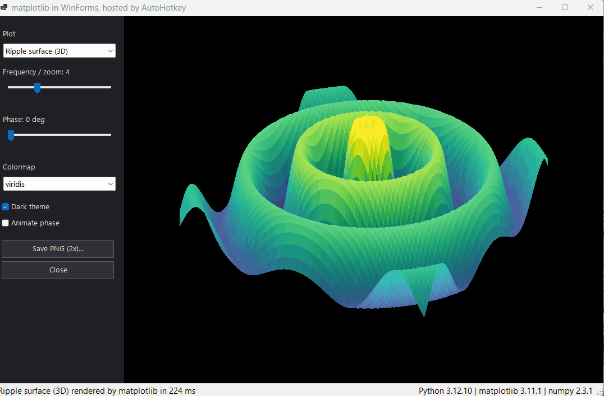
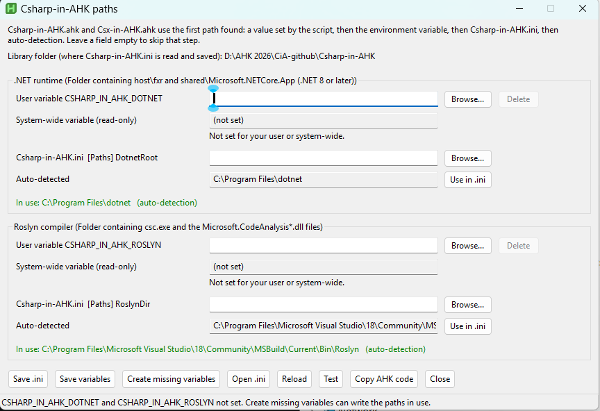

# Csharp-in-AHK

Run C# code inside AutoHotkey v2. No `dotnet.exe` process is started, and no project files or build steps are needed.

Csharp-in-AHK hosts the .NET runtime (.NET 8 or later, tested on .NET 10) **inside the AutoHotkey process**. It compiles C# source in memory with Roslyn and returns results straight to your AHK script. You get the whole .NET base class library, WinForms and WPF from a single `#Include`.

```ahk
#Requires AutoHotkey v2.0 64-bit
#Include "Csx-in-AHK.ahk"

MsgBox RunCsx('return "Hello from C# on .NET " + Environment.Version;')
```



*[`pyplot1.ahk`](pyplot1.ahk): a C# WinForms window that shows live matplotlib plots from Python, all inside the AutoHotkey process. See [Python examples](#python-examples).*

---

## Features

- **In-process execution.** .NET is loaded once through `hostfxr` and stays resident, so there is no per-call process startup.
- **Two script styles**, each in its own standalone library:
  - **`Csharp-in-AHK.ahk`**: regular C# files with top-level statements, like `dotnet run app.cs`.
  - **`Csx-in-AHK.ahk`**: C# script (`.csx`) syntax via the Roslyn scripting API, like `csi.exe` / `dotnet-script`.
- **Values come back to AHK** as text that AHK can use directly: `bool` becomes `1`/`0`, numbers and dates use the invariant culture, and collections become one item per line.
- **Console output is captured.** `Console.Out` and `Console.Error` are collected and returned or exposed in a global variable.
- **Compilation errors are thrown as AHK errors**, with the compiler diagnostics in the message.
- **Directives:** `#r "Some.dll"`, `#r "nuget: Name, 1.2.3"`, `#:package Name@1.2.3` (NuGet packages, downloaded when missing), and `#load "Other.cs"`.
- **Caching.** The host assembly is compiled once to `%TEMP%`, and compiled scripts are cached for the life of the AHK process.
- **Both libraries can be included together.** They share a single .NET runtime and use separate globals and functions.

## Requirements

| Component | Notes |
|---|---|
| AutoHotkey v2 | **64-bit only** (`AutoHotkey64.exe`) |
| .NET runtime | .NET 8 or later, including **Microsoft.WindowsDesktop.App** |
| Roslyn compiler | The `Roslyn` folder containing `csc.exe` and `Microsoft.CodeAnalysis*.dll`, e.g. from Visual Studio or Build Tools. Without one, the compiler is downloaded from nuget.org automatically (see below). |

### Paths

Both libraries find the .NET runtime and the Roslyn compiler **automatically** the first time a script runs. Usually there is nothing to configure. The first setting found wins:

1. **Your script:** `CSDotnetRoot` / `CSRoslynDir` (Csharp-in-AHK) or `CsxDotnetRoot` / `CsxRoslynDir` (Csx-in-AHK), set before or after the `#Include` and before the first call.
2. **Environment variables:** `CSHARP_IN_AHK_DOTNET` and `CSHARP_IN_AHK_ROSLYN`.
3. **`Csharp-in-AHK.ini`** next to the library. Copy [`Csharp-in-AHK.example.ini`](Csharp-in-AHK.example.ini) and edit it:
   ```ini
   [Paths]
   DotnetRoot=C:\Program Files\dotnet
   RoslynDir=C:\Program Files\Microsoft Visual Studio\18\Community\MSBuild\Current\Bin\Roslyn
   ```
4. **Auto-detection.** For .NET it tries `DOTNET_ROOT`, the registered x64 .NET install, `%ProgramFiles%\dotnet`, then the runtime bundled with Visual Studio. For Roslyn it searches Visual Studio and Build Tools installs, newest first, using `vswhere.exe`, then a compiler downloaded earlier by step 5.
5. **Download (Roslyn only).** If no Roslyn was found, Microsoft's compiler package [Microsoft.Net.Compilers.Toolset](https://www.nuget.org/packages/Microsoft.Net.Compilers.Toolset) 5.9.0 (about 22 MB) is downloaded once from nuget.org. Its `tasks\net472` folder is extracted into `%LOCALAPPDATA%\Csharp-in-AHK\roslyn` and used. That folder has `csc.exe` and all the Roslyn DLLs both libraries need, so neither Visual Studio nor Build Tools is required. Extraction uses Windows' own `tar.exe` (Windows 10 1803 or later). To use another version, extract that package's `tasks\net472` folder yourself and set it as `RoslynDir`.

Both libraries read the same environment variables and `.ini` file, so one setting covers both. A path you set in steps 1-3 is never replaced by auto-detection or a download. If it is wrong, you get an error that says where the path came from.

[`Csharp-in-AHK-Paths.ahk`](Csharp-in-AHK-Paths.ahk) is a small GUI that shows the detected paths and the path each library will use. It shows the user and system-wide environment variables, can create the missing ones with the paths in use (no registry editing needed), edits the user variables and `Csharp-in-AHK.ini`, and tests the result. If no Roslyn is found, it says the compiler will be downloaded on first use. Test then downloads it, and the GUI shows the new folder as auto-detected. It must be in the same folder as both libraries, because it edits the `Csharp-in-AHK.ini` they read. If a library is missing, it says which one and exits.



> Don't set `DOTNET_ROOT` just for these libraries. Other .NET programs use it to find their runtime. Use `CSHARP_IN_AHK_DOTNET` instead.
>
> Programs that are already running, such as VS Code or Explorer, don't see a new or changed environment variable until you restart them.

The libraries look for these files in those folders:

| Setting | Must contain |
|---|---|
| `CSDotnetRoot` / `CsxDotnetRoot` | `host\fxr\<version>\hostfxr.dll`<br>`shared\Microsoft.NETCore.App\<version>\` (.NET 8 or later)<br>`shared\Microsoft.WindowsDesktop.App\<version>\` (optional, needed for WinForms/WPF) |
| `CSRoslynDir` | `csc.exe`<br>`Microsoft.CodeAnalysis.dll`<br>`Microsoft.CodeAnalysis.CSharp.dll` |
| `CsxRoslynDir` | `csc.exe`<br>`Microsoft.CodeAnalysis.dll`<br>`Microsoft.CodeAnalysis.CSharp.dll`<br>`Microsoft.CodeAnalysis.Scripting.dll`<br>`Microsoft.CodeAnalysis.CSharp.Scripting.dll` |

`csc.exe` is the only executable used. It runs once to compile the embedded host assembly. Scripts themselves are compiled in memory through the Roslyn DLLs. A standalone .NET install, such as `C:\Program Files\dotnet`, also works as the .NET root.

If a required file is missing, the library throws an error that names the setting to fix and where its value came from.

## Installation

1. Clone or download this repository.
2. Copy `Csharp-in-AHK.ahk` and/or `Csx-in-AHK.ahk` next to your script, or into your AHK `Lib` folder.
3. If auto-detection doesn't find the right .NET or Roslyn, set the paths as shown above. If no Roslyn is installed at all, the first script run downloads it.
4. `#Include` the library you want.

---

## Csharp-in-AHK: top-level C# programs

```ahk
#Include "Csharp-in-AHK.ahk"

Result := RunCSharp('Console.WriteLine(DateTime.Now);')           ; inline source
Result := RunCSharp("script.cs", "arg1", "arg2")                   ; path to an existing .cs file
Result := RunCSharpFile("script.cs", "arg1", "arg2")               ; always treated as a path
```

| Item | Description |
|---|---|
| Return value | Console output, or the value passed to `AHK.Return(value)` |
| `CSOutput` | Console output of the last script |
| `CSExitCode` | The script's `int` return value, or the HRESULT of an unhandled exception |
| `CSStreams` | Bitmask of captured streams: `1` = `Console.Out`, `2` = `Console.Error` (default `3`) |
| `args` | Extra parameters passed to `RunCSharp` |

```ahk
MsgBox RunCSharp('Console.WriteLine(string.Join(", ", args)); return args.Length;', "first", "second")
    . "`nExit code: " CSExitCode

MsgBox RunCSharp('Console.WriteLine("Computing..."); AHK.Return(Math.Sqrt(2));')
    . "`nConsole output: " CSOutput
```

`AHK.Return()` does not stop the script. If it is called more than once, the last call wins.

## Csx-in-AHK: C# scripts

```ahk
#Include "Csx-in-AHK.ahk"

MsgBox RunCsx('DateTime.Now.ToString("dddd, d MMMM yyyy")')   ; a final expression is returned

Area := RunCsx('Math.PI * Math.Pow(double.Parse(args[0]), 2)', 3)
MsgBox "Area: " Round(Area, 2)

if RunCsx('File.Exists(@"C:\Windows\notepad.exe")')            ; booleans come back as 1/0
    MsgBox "Notepad exists"
```

Statements, functions, classes and `await` can be mixed freely at the top level:

```ahk
MsgBox RunCsx('
(
    record Person(string Name, int Age);
    int Twice(int x) => x * 2;

    await Task.Delay(10);
    var people = new[] { new Person("Ann", 34), new Person("Bob", 27) };
    return string.Join(", ", people.Select(p => $"{p.Name} ({Twice(p.Age)})"));
)')
```

| Item | Description |
|---|---|
| Return value | The script's `return` value or final expression. If that is `null`, the console output is returned instead. |
| `CsxOutput` | Console output of the last script |
| `CsxStreams` | Bitmask of captured streams: `1` = `Console.Out`, `2` = `Console.Error` (default `3`) |
| `args` | Extra parameters passed to `RunCsx` |

A script file is recompiled automatically when it, or any file it `#load`s, changes.

## Common behavior

- **Implicit usings:** `System`, `System.Collections.Generic`, `System.IO`, `System.Linq`, `System.Net.Http`, `System.Threading`, `System.Threading.Tasks` (plus `System.Text` in Csx). All .NET and Windows Desktop assemblies are referenced.
- **Relative paths** in directives are resolved against the script's folder, or the working directory for inline scripts.
- **NuGet packages** are restored the way `dotnet run app.cs` restores them, including dependencies and native DLLs. See [NuGet packages](#nuget-packages).
- **`Environment.Exit()`** inside a script also terminates AutoHotkey, because both run in the same process.

## How it works

1. On first use, the library loads `hostfxr.dll` from the configured .NET root. It starts the runtime with a generated `runtimeconfig.json` that targets `Microsoft.WindowsDesktop.App`.
2. A small C# host, embedded in the `.ahk` file as source, is compiled once with Roslyn `csc.exe` into `%TEMP%\CSharp-in-AHK\` or `%TEMP%\Csx-in-AHK\`. The file name includes a CRC of the host source, runtime version and compiler version, so the host is rebuilt automatically when any of them changes.
3. AHK calls the host's `[UnmanagedCallersOnly]` entry points (`Init`, `Run`) directly through `DllCall`.
4. User scripts are compiled in memory with the Roslyn assemblies and executed. Results and captured output are marshalled back as UTF-16 strings.

If one library has already started .NET, the other reuses the same runtime.

## NuGet packages

`#:package Name@version` and `#r "nuget: Name, version"` work in both libraries:

```csharp
#:package Microsoft.Data.Sqlite@8.0.0
using Microsoft.Data.Sqlite;
```

- The first package reference downloads the NuGet client libraries (NuGet.Commands 7.9.0 and its dependencies, about 4 MB) from nuget.org into `%LOCALAPPDATA%\Csharp-in-AHK\nuget\client`. No .NET SDK is needed.
- Packages are restored with dependencies into the global NuGet folder (`~\.nuget\packages`), using your `nuget.config` sources and credentials. Native DLLs (`runtimes\win-x64\native`) are loaded when the package calls them.
- Versions follow NuGet: `1.2.3` means 1.2.3 or the lowest version above it, `*` the newest stable version, `1.*` the newest 1.x, and `[1.0,2.0)` a range. Without a version, `*` is used.
- The resolved file list is cached in `%LOCALAPPDATA%\Csharp-in-AHK\nuget\restore`, so later runs start without restoring. Versions containing `*` are checked for updates once a day. If that check fails, for example when offline, the last result is used.
- The NuGet client runs in its own `AssemblyLoadContext`, so its dependencies (such as Newtonsoft.Json) do not clash with the packages your script uses.

## Examples

| File | Description |
|---|---|
| [`Csharp-in-AHK-Paths.ahk`](Csharp-in-AHK-Paths.ahk) | GUI for the path settings: environment variables, `Csharp-in-AHK.ini`, auto-detection and a test run of both libraries |
| [`cs_ex1.ahk`](cs_ex1.ahk) | Demos for `RunCSharp`: output, args, exit codes, exceptions, `AHK.Return` |
| [`csx_ex1.ahk`](csx_ex1.ahk) | Demos for `RunCsx`: return values, collections, records, `await`, files, compile errors |
| [`winforms_ex1.ahk`](winforms_ex1.ahk) | Minimal WinForms dialog that returns the user's input to AHK |
| [`wpf_ex1.ahk`](wpf_ex1.ahk) | Minimal WPF window that returns the user's input to AHK |
| [`types_ex1.ahk`](types_ex1.ahk) | `RunCsx`: passing AHK integers, floats, strings, booleans, dates, arrays and Maps to C# and using the results in AHK |
| [`cs_types_ex1.ahk`](cs_types_ex1.ahk) | The same with `RunCSharp` (top-level statements): results via `AHK.Return`, console output and the exit code, plus a local function and a `record` |
| [`Example.csx`](Example.csx) / [`ExampleHelpers.csx`](ExampleHelpers.csx) | A script file that uses `#load` to pull in helper functions and classes |
| [`pynet1.ahk`](pynet1.ahk) / [`pynet1.cs`](pynet1.cs) | Python inside AutoHotkey through [Python.NET](https://github.com/pythonnet/pythonnet): calling Python functions from C#, `import math`, `eval`, `print()` captured in the output |
| [`pyplot1.ahk`](pyplot1.ahk) / [`pyplot1.cs`](pyplot1.cs) | WinForms and matplotlib in one window: five plots (3D surface, Lissajous, polar rose, Mandelbrot, complex phase field) with live sliders, colormaps, dark theme, animation and PNG export. The saved file's path is returned to AHK |
| [`pynet.cs`](pynet.cs) | The `Pynet` helper class used by both Python examples (`#load "pynet.cs"`), adapted from a LibreAutomate script by its developer |

The demos show their results with `MsgBox`.

### Python examples

The Python examples need some extra setup:

- **Python 3.10 or later, 64-bit.** The path to its DLL is set at the top of `pynet.cs` (e.g. `...\Python312\python312.dll`). You can also set the `PYTHONNET_PYDLL` environment variable instead. `pyplot1` also needs matplotlib and numpy (`pip install matplotlib`).
- The Python engine stays loaded for the life of the AHK process, so later scripts reuse it. It cannot be restarted after `PythonEngine.Shutdown()`, so both examples call that only from `OnExit`.
- `Pynet` always uses the Python installation its DLL belongs to. An inherited `VIRTUAL_ENV` variable, for example from a VS Code terminal, is ignored. Set `PYTHONHOME` to override this.

---

## Credits

- **Code:** written by **[Claude](https://www.anthropic.com/claude)** (Anthropic), working through Claude Code under the direction of [burque505](https://github.com/burque505).
- **Inspiration:** the idea, but no code, comes from *Powershell-in-AHK*, https://www.autohotkey.com/boards/viewtopic.php?f=83&t=141178, by user -+_[] .
- **CLR interop:** based on concepts and techniques from **CLR.ahk** by Lexikos.
- **NuGet support:** modeled on the NuGet package provider of [Keysharp](https://github.com/keysharp-org/Keysharp) (no code taken).

## License

Released under the [MIT License](LICENSE). © 2026 burque505
